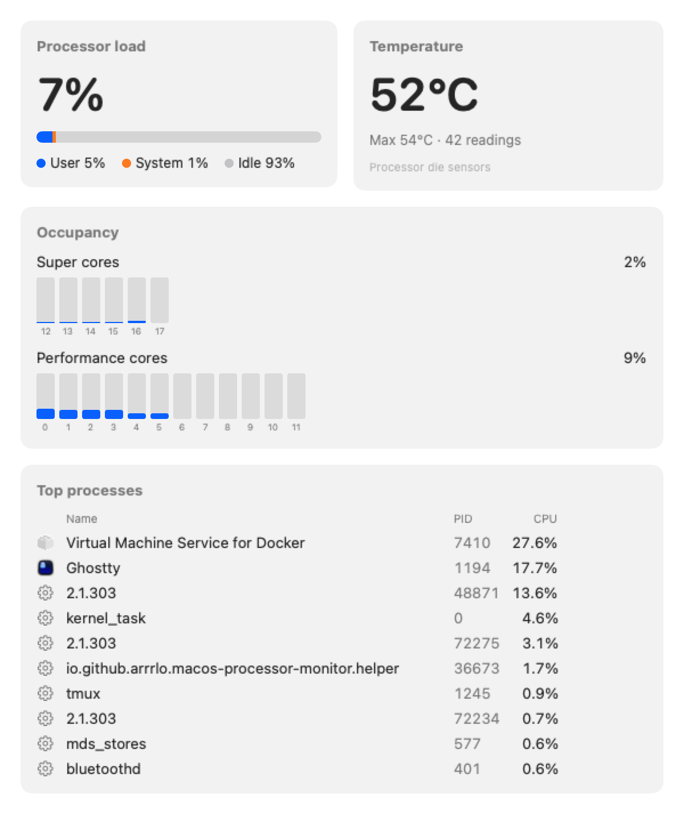

# macOS Processor Monitor

A lightweight, native menu bar monitor for Apple Silicon processors.

[](https://github.com/arrrlo/macos-processor-monitor/actions/workflows/ci.yml)
[](https://github.com/arrrlo/macos-processor-monitor/releases/latest)
[](LICENSE)


The menu bar shows the processor load and temperature next to a chip icon, e.g. `23%  49°C`.
Click it for every metric and the top processes, or open the dashboard:

<p align="center">
  <picture>
    <source media="(prefers-color-scheme: dark)" srcset="docs/images/dashboard-dark.png">
    
  </picture>
</p>

<sub>Live readings from an M5 Max (6 Super + 12 Performance cores), rendered by `make screenshots`.</sub>

## Features

- **Menu bar item** with the current processor load and temperature, e.g. `23%  49°C`.
- **Processor load** with its user / system / idle split.
- **Occupancy** of every core, grouped by core cluster. Cluster names come from the chip itself:
  *Super* and *Performance* on M5, *Performance* and *Efficiency* on earlier chips.
- **Processor temperature**, the average and maximum of the chip's die sensors.
- **Top 10 processes** by CPU usage, system-wide (including `WindowServer`, `kernel_task` and other
  system processes), with app names and icons.
- **Dashboard window** with all of the above, plus a per-core chart.
- **Starts at login**, with a refresh interval of 1, 2 or 5 seconds.
- **Built to stay out of the way.** One timer with leeway so macOS can batch wake-ups. Processes are
  only measured while you look at them. Nothing runs while the displays sleep.

## Install

1. Download `macos-processor-monitor-<version>.pkg` from the
   [latest release](https://github.com/arrrlo/macos-processor-monitor/releases/latest) and open it.
2. The installer is not notarized (that needs a paid Apple Developer account), so macOS blocks it
   the first time. Open **System Settings › Privacy & Security**, scroll to the message about the
   installer and click **Open Anyway**.

Installing from Terminal skips the Gatekeeper step, because `curl` does not quarantine downloads:

```sh
curl -LO https://github.com/arrrlo/macos-processor-monitor/releases/latest/download/macos-processor-monitor-1.0.0.pkg
sudo installer -pkg macos-processor-monitor-1.0.0.pkg -target /
```

Requirements: a Mac with Apple Silicon and macOS 14 Sonoma or later.

The installer puts these files on your Mac:

| What | Where |
|---|---|
| The app | `/Applications/macOS Processor Monitor.app` |
| Helper that measures all processes (root, on demand) | `/Library/PrivilegedHelperTools/io.github.arrrlo.macos-processor-monitor.helper` |
| Its launchd job | `/Library/LaunchDaemons/io.github.arrrlo.macos-processor-monitor.helper.plist` |
| Login item | `/Library/LaunchAgents/io.github.arrrlo.macos-processor-monitor.plist` |

## Usage

Click the processor icon in the menu bar to see:

- **Processor load** with user, system and idle shares
- **Temperature**, average and maximum
- **Occupancy** for each core cluster
- **Top processes**, the 10 processes using the most CPU. Values are a percentage of one core, as
  in Activity Monitor, so a process can exceed 100%.
- **Open Dashboard…** (⌘D) opens the dashboard window.
- **Refresh Interval** sets how often readings update: 1, 2 (default) or 5 seconds.
- **Launch at Login** turns the automatic start on or off for your user account.
- **About** and **Quit**

Apps cannot start before anyone logs in, so the monitor starts at login rather than at boot. With
automatic login enabled, that happens right after startup.

## Uninstall

```sh
sudo "/Applications/macOS Processor Monitor.app/Contents/Resources/uninstall.sh"
```

## How it works

| Metric | Source |
|---|---|
| Load and per-core occupancy | `host_processor_info(PROCESSOR_CPU_LOAD_INFO)`. Per-core tick counters are compared between samples. |
| Core clusters | `hw.perflevelN.*` sysctls, plus each core's cluster type from `IODeviceTree:/cpus` (core numbering does not follow cluster order). |
| Temperature | Die temperature sensors read through the IOHID event system (`PMU tdie*` on M5; per-cluster sensors on chips that have them). |
| Top processes | `proc_pidinfo(PROC_PIDTASKALLINFO)` CPU time deltas for every process. |

**Why a root helper?** macOS only lets administrators read the CPU time of other users'
processes. That covers about a third of all processes, including `WindowServer` and `kernel_task`.
The helper is the only part that runs as root. It is read-only and has a single XPC method.
launchd starts it when the menu or dashboard asks for data, and it quits 30 seconds after the last
request. If it is missing, the app falls back to your own processes and says so. Details are in
[SECURITY.md](SECURITY.md).

**Overhead.** <!-- OVERHEAD -->

## Privacy

The app makes no network connections and collects nothing. The only thing it stores is your
refresh interval preference.

## Build from source

You need the Xcode Command Line Tools with Swift 6.4 (`xcode-select --install`). Xcode itself is
not required.

```sh
make test   # unit tests
make gate   # tests + 100% coverage + CRAP ≤ 16
make run    # build the release .app and launch it
make pkg    # build/macos-processor-monitor-<version>.pkg
```

`make help` lists everything. The code is organised as:

| Module | Contents |
|---|---|
| `ProcessorMonitorCore` | Pure logic: load and occupancy math, topology, temperature aggregation, process usage, sampling engine, menu text |
| `ProcessorMonitorSystem` | Thin adapters over Mach, libproc, IOKit/HID, sysctl, launchd and XPC |
| `ProcessorMonitorUI` | AppKit status item and menu, SwiftUI dashboard, app wiring |
| `ProcessorMonitor`, `ProcessorMonitorHelper` | Entry points of the app and the root helper |
| `Tools/` | `pmtools`, the project's own coverage, CRAP and mutation-testing tool |

## Quality

The project was built test-first, and these rules are enforced in CI:

- **100% coverage** of lines, functions and regions in every source file. Only the two
  `main.swift` entry points are excluded.
- **CRAP ≤ 16** for every function. CRAP combines cyclomatic complexity with coverage.
- **Mutation testing.** Every mutant must be killed: flipped comparisons, swapped `&&`/`||` and
  arithmetic, negated booleans, and removed calls. Run it with `make mutate`.

See [CONTRIBUTING.md](CONTRIBUTING.md) for the workflow.

## License

[MIT](LICENSE) © 2026 Ivan Arar
